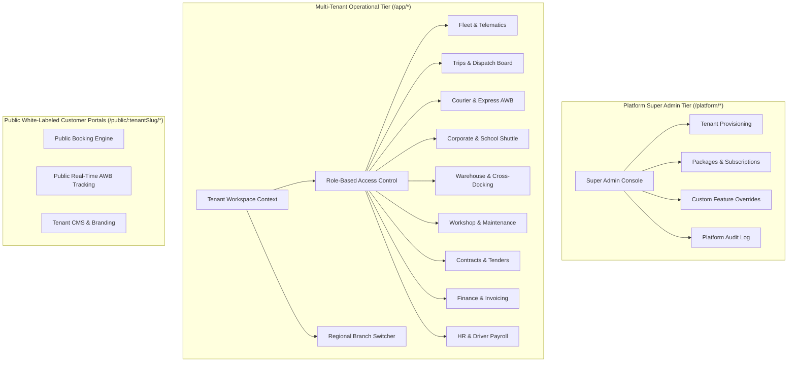
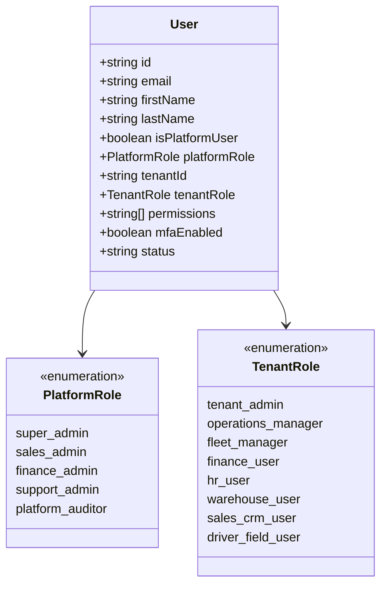
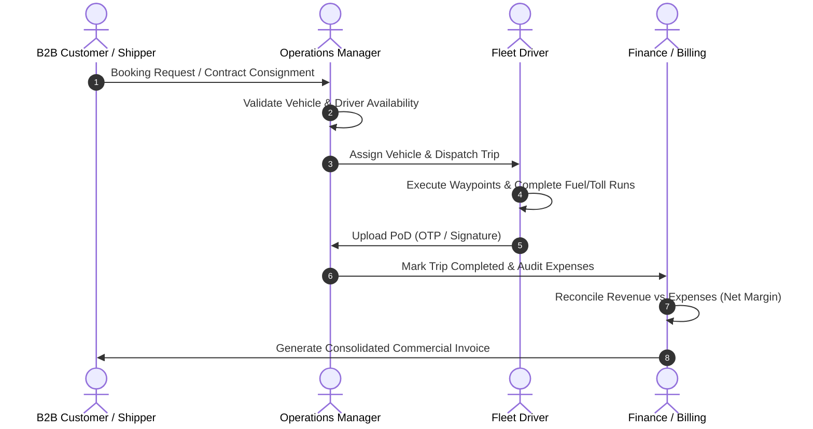
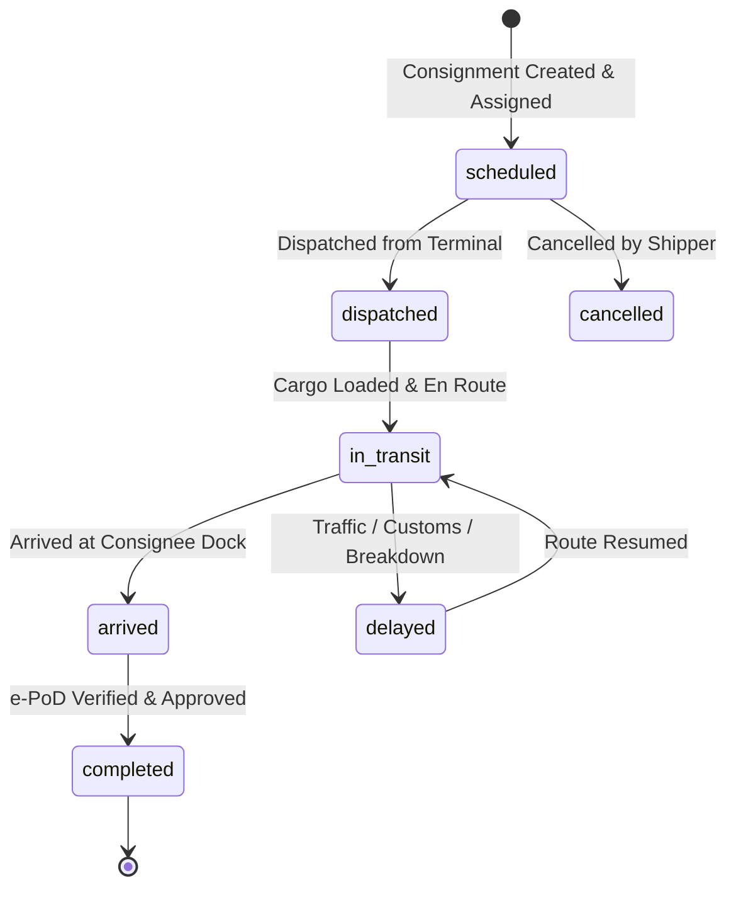
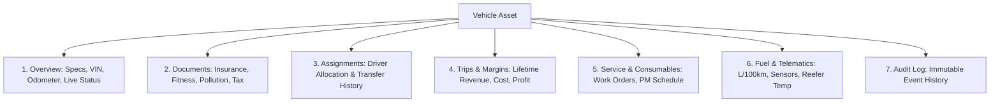
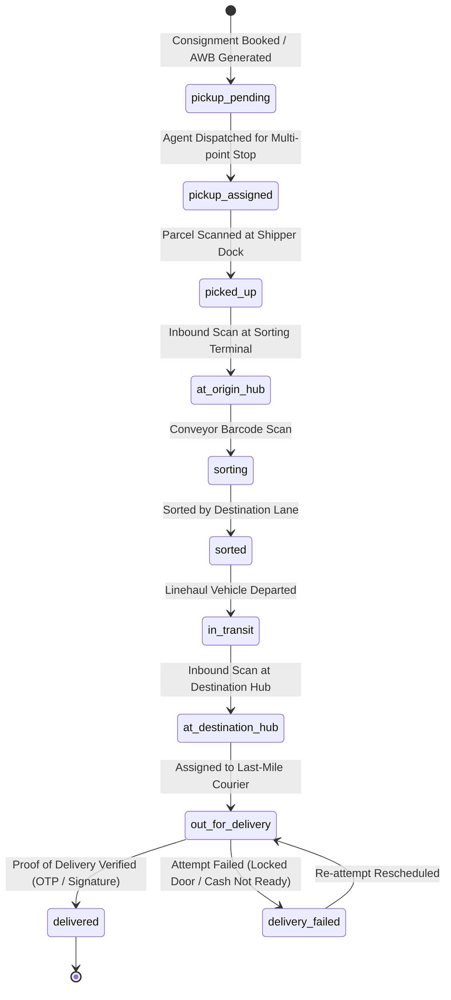
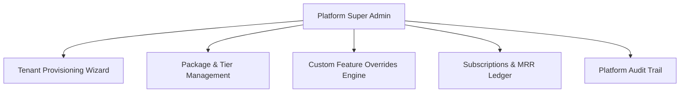

# OmniCore Logistics & Fleet Ecosystem: Master Operations & Workflow Guide

> **Confidential & Proprietary** • **OmniCore Enterprise Multi-Tenant Platform**  
> **Document Version**: 3.0 • **Target Audience**: System Administrators, Operations Directors, Fleet Managers, and Platform Engineers

---

## 1. Executive Overview & System Architecture

**OmniCore** is an enterprise-grade, multi-tenant Software-as-a-Service (SaaS) and Enterprise Resource Planning (ERP) platform designed for end-to-end logistics, fleet telemetry, supply chain fulfillment, and specialized passenger mobility. 

The application unifies multi-branch fleet control, freight dispatching, contract billing, preventive maintenance, courier delivery, and warehouse logistics into a single normalized data model.



### 1.1 Technical Stack
* **Frontend**: React 19, TypeScript (Strict Mode), Vite (Hot Module Replacement).
* **Styling**: Tailwind CSS with custom glassmorphic dark themes, dynamic status badges, and responsive layouts.
* **Server State & Caching**: TanStack React Query (`@tanstack/react-query`) for asynchronous query synchronization and mutation rollbacks.
* **Network & API Client**: Axios instance with automatic Django REST Framework (DRF) JWT token refresh rotation interceptors and multi-tenant `X-Tenant-ID` header injection.
* **Graceful Offline Simulation**: Production fallback to comprehensive mock fixtures in [mockData.ts](file:///d:/ELA_APPLICATIONS_FRONTEND/OmniCoreFront/OmniCoreFrontend/src/api/mockData.ts) ensuring seamless local demonstrations and UI validation without network dependencies.

---

## 2. User Roles & RBAC Permission Architecture

OmniCore enforces authorization at two independent levels: **Platform Level** (Super Admin ecosystem) and **Tenant Level** (Organization workspace).



### 2.1 Role Definitions

#### A. Platform Roles (`isPlatformUser: true`)
| Role | Portal Scope | Key Responsibilities |
| :--- | :--- | :--- |
| **`super_admin`** | `/platform/*` | Full global privileges. Provisions new tenants, configures license tiers, sets individual tenant feature flags, and reviews platform-wide audit events. |
| **`sales_admin`** | `/platform/*` | Manages subscription growth, pipeline conversion, and customer renewal timelines. |
| **`finance_admin`** | `/platform/*` | Oversees platform-wide billing, MRR collections, and Stripe/payment gateway reconciliations. |
| **`support_admin`** | `/platform/*` | Platform health monitoring, tenant ticketing, and diagnostics. |
| **`platform_auditor`** | `/platform/*` | Read-only compliance inspection of tenant logs and data retention policies. |

#### B. Tenant Roles (`isPlatformUser: false`)
| Role | Primary Views | Responsibilities & Restrictions |
| :--- | :--- | :--- |
| **`tenant_admin`** | `/app/*` (All) | Executive authority for the tenant. Manages company profile, subscription upgrades, user provisioning, role assignments, and branch setups. |
| **`operations_manager`** | Fleet, Trips, Courier, Shuttle, Warehouse | Dispatches vehicles, manages drivers, schedules trips, tracks live telematics. Read-only on corporate finance. |
| **`fleet_manager`** | Fleet, Maintenance, Fuel, Accidents | Asset lifecycle, statutory document renewals, workshop work orders, fuel logging, and accident claims. |
| **`finance_user`** | Finance, Invoicing, Payroll, Contracts | Invoice generation, accounts receivable/payable, fuel/toll expense approval, and driver payroll management. |
| **`hr_user`** | HR Directory, Driver Profiles | Staff records, CDL compliance, employment contracts, and driver performance scores. |
| **`warehouse_user`** | Warehouse, Cross-Docking | Spare parts inventory, tire storage, cross-dock terminal routing, and LTL shipment consolidation. |
| **`sales_crm_user`** | CRM, Contracts & Tenders | Customer accounts, B2B dedicated haulage tenders, SLA agreements, and billing rate sheets. |
| **`driver_field_user`** | Trips (Assigned), Vehicle Manifest | Mobile-oriented view: assigned run-sheets, waypoint status updates, and digital Proof-of-Delivery (PoD) capture. |

---

### 2.2 Granular Permissions Matrix

Permissions are represented as scoped tokens (`domain.action`) evaluated by the central `can(permission: string)` engine in [TenantContext.tsx](file:///d:/ELA_APPLICATIONS_FRONTEND/OmniCoreFront/OmniCoreFrontend/src/contexts/TenantContext.tsx):

```mermaid
flowchart TD
    Req[Permission Evaluation: can(perm)] --> CheckPlat{user.isPlatformUser?}
    CheckPlat -- Yes --> Grant[ALLOW ACCESS]
    CheckPlat -- No --> CheckWild{permissions includes '*'}
    CheckWild -- Yes --> Grant
    CheckWild -- No --> CheckRole{tenantRole == 'tenant_admin'?}
    CheckRole -- Yes --> Grant
    CheckRole -- No --> CheckExact{permissions includes perm?}
    CheckExact -- Yes --> Grant
    CheckExact -- No --> CheckPrefix{permissions includes 'domain.*'?}
    CheckPrefix -- Yes --> Grant
    CheckPrefix -- No --> Deny[DENY ACCESS / RENDER FALLBACK]
```

| Permission Token | Description | UI Enforcement Points |
| :--- | :--- | :--- |
| `*` | Global master permission wildcard | Bypasses all security checks |
| `vehicle.create` / `update` / `delete` | Manage vehicle assets in fleet directory | Action buttons in [FleetList.tsx](file:///d:/ELA_APPLICATIONS_FRONTEND/OmniCoreFront/OmniCoreFrontend/src/features/fleet/FleetList.tsx) |
| `vehicle.view` | Read-only inspection of fleet | Fleet table & drawer visibility |
| `driver.create` / `update` / `view` | Driver onboarding & license verification | [DriverList.tsx](file:///d:/ELA_APPLICATIONS_FRONTEND/OmniCoreFront/OmniCoreFrontend/src/features/drivers/DriverList.tsx) |
| `trip.create` / `dispatch` / `update` | Create consignments and assign drivers/trucks | [TripsHub.tsx](file:///d:/ELA_APPLICATIONS_FRONTEND/OmniCoreFront/OmniCoreFrontend/src/features/trips/TripsHub.tsx) & [DispatchBoard.tsx](file:///d:/ELA_APPLICATIONS_FRONTEND/OmniCoreFront/OmniCoreFrontend/src/features/trips/DispatchBoard.tsx) |
| `payroll.view` | Inspect compensation and wage numbers | **Masks salaries** in [DriverProfileDrawer.tsx](file:///d:/ELA_APPLICATIONS_FRONTEND/OmniCoreFront/OmniCoreFrontend/src/features/drivers/DriverProfileDrawer.tsx) & [HrHub.tsx](file:///d:/ELA_APPLICATIONS_FRONTEND/OmniCoreFront/OmniCoreFrontend/src/features/hr/HrHub.tsx) with a "Confidential" lock badge if absent |
| `payroll.manage` | Process driver disbursements & bonus payouts | Driver payroll approval actions |
| `finance.view` | View invoices, cash flow, and net trip margins | Sidebar link, `/app/finance` route, and dashboard profit widgets |
| `finance.manage` | Create invoices, reconcile payments, approve payouts | Invoice creation modals & payout approvals |
| `contract.create` / `approve` / `view`| Corporate haulage tenders & agreements | [ContractsHub.tsx](file:///d:/ELA_APPLICATIONS_FRONTEND/OmniCoreFront/OmniCoreFrontend/src/features/contracts/ContractsHub.tsx) |
| `maintenance.create` / `manage` | Open work orders & assign mechanics | [MaintenanceHub.tsx](file:///d:/ELA_APPLICATIONS_FRONTEND/OmniCoreFront/OmniCoreFrontend/src/features/maintenance/MaintenanceHub.tsx) |
| `warehouse.manage` / `view` | Cross-docking & spare parts operations | [WarehouseHub.tsx](file:///d:/ELA_APPLICATIONS_FRONTEND/OmniCoreFront/OmniCoreFrontend/src/features/warehouse/WarehouseHub.tsx) |
| `settings.manage` | Edit organization profile, verticals, & add-ons | [TenantSettings.tsx](file:///d:/ELA_APPLICATIONS_FRONTEND/OmniCoreFront/OmniCoreFrontend/src/features/settings/TenantSettings.tsx) |

---

## 3. Multi-Tenancy & Multi-Branch Architecture

### 3.1 Tenant Isolation & Data Scoping
* **Tenant Identification**: Every organization operates under a unique `tenantId` (e.g., `tenant_apex`, `tenant_metro`).
* **HTTP Header Injection**: All API requests carry `X-Tenant-ID: <active_tenant_id>`. Backend data partitions are isolated at the database schema/row level.
* **Tenant Lifecycle States**:
  * `active`: Normal operations enabled.
  * `trial`: Time-limited trial evaluation.
  * `suspended`: Access blocked by [TenantGuard.tsx](file:///d:/ELA_APPLICATIONS_FRONTEND/OmniCoreFront/OmniCoreFrontend/src/components/guards/TenantGuard.tsx) with a branded account restoration screen.

### 3.2 Regional Branch Network (`BranchSwitcher`)
Large enterprise logistics operators manage multiple regional depots, sorting hubs, and transit centers:
* Controlled via [BranchSwitcher.tsx](file:///d:/ELA_APPLICATIONS_FRONTEND/OmniCoreFront/OmniCoreFrontend/src/components/layout/BranchSwitcher.tsx) in the top navigation bar.
* **Scoping Options**:
  * `All Branches / Enterprise`: Global unfiltered operational view.
  * `Regional Hub (e.g., Chicago North Depot - ORD-1)`: Scopes vehicle lists, dispatches, driver rosters, and inventory to that physical facility.
* Branch selection persists in `localStorage` (`omnicore_active_branch`).

### 3.3 Subscription Tiers & Add-ons
Tiers control resource ceilings and baseline modules:
* `basic`: Small fleets (up to 10 vehicles), essential trip dispatch.
* `standard`: Medium fleets (up to 50 vehicles), maintenance scheduling and telematics.
* `corporate`: Fleets up to 200 vehicles, CRM, contracts, marketing, and cross-docking.
* `enterprise`: Unlimited vehicles, all specialized transport verticals, and dedicated support.

**Modular Add-on Capabilities**:
* `addon_cold_chain`: Real-time temperature sensors and thermal breach alarms.
* `addon_telematics`: Advanced GPS breadcrumbs, speeding alerts, and geofencing.
* `addon_contracts`: Corporate tenders, SLA tracking, and milestone billing.
* `addon_warehouse`: Spare parts inventory and multi-day LTL consolidation.
* `addon_last_mile`: Doorstep courier dispatch and Cash-on-Delivery (COD) reconciliation.
* `addon_maintenance_pro`: Predictive maintenance work orders and tire life tracking.

---

## 4. End-to-End Operational Workflows



---

### 4.1 Trip Management, Dispatching & Margins

Trips represent commercial freight journeys and passenger transits. Managed via [TripsHub.tsx](file:///d:/ELA_APPLICATIONS_FRONTEND/OmniCoreFront/OmniCoreFrontend/src/features/trips/TripsHub.tsx) and [DispatchBoard.tsx](file:///d:/ELA_APPLICATIONS_FRONTEND/OmniCoreFront/OmniCoreFrontend/src/features/trips/DispatchBoard.tsx).

#### A. Booking & Trip Creation
1. Navigate to **Bookings & Dispatch** (`/app/trips`).
2. Click **Create Consignment / New Trip**.
3. Specify:
   * **Origin & Destination**: Pickup and delivery addresses with scheduled time windows.
   * **Cargo Parameters**: Weight in kg, volume in CBM, cargo type (e.g., `dry_freight`, `cold_chain_pharma`, `container`).
   * **Financial Rates**: Commercial Billing Rate (what the client pays) and estimated driver allowance.
4. System automatically checks vehicle capacity constraints.

#### B. Driver & Vehicle Allocation (Strict Anti-Conflict Rules)
The platform enforces hard operational safety rules in [VehicleDetailsDrawer.tsx](file:///d:/ELA_APPLICATIONS_FRONTEND/OmniCoreFront/OmniCoreFrontend/src/features/fleet/VehicleDetailsDrawer.tsx):
* **Active Transit Lock**: You **cannot** reassign a driver who is currently on an active drive (`status === 'in_transit'`).
* **Vehicle Grounding Lock**: Vehicles with status `grounded`, `breakdown`, `maintenance`, or `accident` cannot be assigned to new trips until cleared by a work order.
* **Automatic Status Sync**: Dispatching a trip flips vehicle status to `on_trip` and driver status to `on_trip`.

#### C. Trip Lifecycle States


#### D. Real-Time Net Profit Margin Calculation
For every trip, OmniCore computes real-time operational profitability:

$$\text{Net Profit Margin} = \text{Commercial Billing Rate} - \sum(\text{Fuel} + \text{Tolls} + \text{Driver Allowance} + \text{Loading/Unloading} + \text{Maintenance Overhead})$$

$$\text{Margin \%} = \left(\frac{\text{Net Margin}}{\text{Commercial Billing Rate}}\right) \times 100$$

Trips falling below an acceptable profit margin threshold (e.g., < 15%) trigger visual warning badges for financial review.

---

### 4.2 Fleet Asset Management & Vehicle Deep-Dive

Fleet assets are managed in [FleetList.tsx](file:///d:/ELA_APPLICATIONS_FRONTEND/OmniCoreFront/OmniCoreFrontend/src/features/fleet/FleetList.tsx). Clicking any vehicle opens the comprehensive 7-tab drawer [VehicleDetailsDrawer.tsx](file:///d:/ELA_APPLICATIONS_FRONTEND/OmniCoreFront/OmniCoreFrontend/src/features/fleet/VehicleDetailsDrawer.tsx):



#### 1. Overview Tab
* Visual asset badge, license plate, chassis/VIN, vehicle class (`heavy_truck`, `reefer_cold`, `flatbed`, `bus`, `container`), fuel type, and payload limits.
* Live status toggling (`available`, `on_trip`, `maintenance`, `grounded`, `breakdown`, `accident`, `reserved`).

#### 2. Regulatory Compliance & Documents Tab
* Manages statutory documents: **Commercial Insurance**, **Road Fitness Certificate**, **Pollution Under Control (PUC)**, **National Permit**, and **Road Tax**.
* **Automatic Expiration Warning**:
  * Green: Valid (> 30 days remaining).
  * Amber: Expiring soon (within 30 days).
  * Red: Expired (alerts displayed across the app).
* Administrators can upload new documents and remove obsolete records.

#### 3. Driver Assignment Tab
* Binds or unbinds primary drivers with conflict detection.
* Preserves full transfer logs showing previous vehicle assignments.

#### 4. Trips & Lifetime Margins Tab
* Aggregates total historical mileage, trips completed, lifetime gross billing, total expenses incurred, and net contribution margin.

#### 5. Service & Consumables Tab
* Links to open and completed maintenance work orders.
* Tracks odometer at last service and automatically calculates `nextServiceKm`.

#### 6. Fuel & Telematics Tab
* Logs fuel efficiency ($L/100\text{km}$) and cost per km ($/km).
* Specialized sensors: For Cold Chain reefers, shows live ambient vs. cargo temperature ($^\circ\text{C}$), defrost status, and compressor health.

#### 7. Audit Log Tab
* Timestamped chronicle recording who changed vehicle specs, reallocated drivers, or modified operational statuses.

---

### 4.3 Fuel & Accident Management

#### A. Fuel Management Tab ([FuelManagementTab.tsx](file:///d:/ELA_APPLICATIONS_FRONTEND/OmniCoreFront/OmniCoreFrontend/src/features/fleet/FuelManagementTab.tsx))
* Tracks fuel dispensing across company depots and commercial retail pumps.
* Logs odometer at fill, quantity in liters, unit price, total cost, fuel card number, and receipt invoice scan.
* **Anomaly Detection**: Flags sudden drops in fuel economy (indicative of fuel theft or engine injector malfunctions).

#### B. Accident & Claims Management ([AccidentManagementTab.tsx](file:///d:/ELA_APPLICATIONS_FRONTEND/OmniCoreFront/OmniCoreFrontend/src/features/fleet/AccidentManagementTab.tsx))
* **Incident Logging**: Records accident date, location, driver involved, severity tier (`minor`, `moderate`, `severe`, `total_loss`), and police report / FIR number.
* **Vehicle Grounding**: Automatically shifts vehicle status to `accident` or `grounded`, removing it from dispatch boards.
* **Insurance Claim Lifecycle**: Tracks claim number, insurance surveyor inspection, estimated repair cost vs. approved payout, and deductible balance.
* **Return to Service**: Closing an accident investigation triggers an inspection checklist before the vehicle is returned to `available` status.

---

### 4.4 Courier & Express Delivery (AWB Workflow)

Managed in [CourierDashboard.tsx](file:///d:/ELA_APPLICATIONS_FRONTEND/OmniCoreFront/OmniCoreFrontend/src/features/courier/CourierDashboard.tsx). Models high-velocity parcel processing:



1. **Authoritative AWB Generation**: Each parcel receives a unique tracking number (e.g., `AWB-EXP-88910`).
2. **Multi-Point Pickup Batches**: High-volume merchant collections are sequenced into stop runs.
3. **Sorting Terminal Hubs**: Barcode scans categorize parcels into sorting chutes (`Air Express`, `Surface North`, `Local Doorstep`).
4. **Electronic Proof-of-Delivery (e-PoD)**: Doorstep delivery is gated by:
   * **SMS OTP Verification**: 4-digit code provided by recipient.
   * **Glass Signature Capture**: Recipient signs directly on screen.
5. **Agent Commission Settlements**: Tracks agent delivery commission and generates payout settlement batches for finance approval.

---

### 4.5 Corporate & School Shuttle Operations

Managed in [ShuttleDashboard.tsx](file:///d:/ELA_APPLICATIONS_FRONTEND/OmniCoreFront/OmniCoreFrontend/src/features/shuttle/ShuttleDashboard.tsx):
* **Fixed Route Topologies**: Routes define ordered transit stops with designated arrival/departure time windows.
* **Shift Management**: Pre-configured shifts (`morning_inbound`, `evening_outbound`, `night_shift`).
* **Digital Passenger Roster**: Tracks employee/student registrations and live seating occupancy.
* **Attendance Logging**: QR/RFID passenger boarding scans recorded in real time.

---

### 4.6 Warehouse, Cross-Docking & Consolidation

Managed in [WarehouseHub.tsx](file:///d:/ELA_APPLICATIONS_FRONTEND/OmniCoreFront/OmniCoreFrontend/src/features/warehouse/WarehouseHub.tsx):

#### A. Cross-Docking Terminal Flow
Bypasses long-term storage by routing incoming goods directly to outgoing linehaul trucks:
$$\text{Inbound Dock Scan} \longrightarrow \text{Sort \& Repackage} \longrightarrow \text{Regional Staging Lane} \longrightarrow \text{Outbound Linehaul Departure}$$

#### B. Multi-Day LTL Consolidation
* Pools smaller Less-Than-Truckload shipments across multiple days.
* Aggregates cubic volume and gross weight until trailer capacity is maximized.
* **Tamper-Evident Master Seal**: Applies a cryptographic seal code (e.g., `SEAL-MIDWEST-9941`) locking the trailer manifest for long-haul departure.

#### C. Spare Parts & Inventory
* Manages fleet consumables: tires, brake pads, engine oil, filters, belts.
* Bin location tracking (e.g., `Shelf B-12, Bin 4`) with low-stock alerts and automatic purchase requisitions.

---

### 4.7 Maintenance, Workshop & Work Orders

Managed in [MaintenanceHub.tsx](file:///d:/ELA_APPLICATIONS_FRONTEND/OmniCoreFront/OmniCoreFrontend/src/features/maintenance/MaintenanceHub.tsx):
* **Work Order Creation**: Categorized as `preventive` (scheduled service), `breakdown` (emergency roadside repair), or `inspection`.
* **Work Order Lifecycle**: `scheduled` $\rightarrow$ `in_progress` $\rightarrow$ `waiting_parts` $\rightarrow$ `completed` $\rightarrow$ `cancelled`.
* **Cost Accounting**: Separates parts expense from technician labor hours.
* **Automatic Service Reset**: Completing a work order updates the vehicle's odometer milestone and calculates the next scheduled service target.

---

### 4.8 B2B Contracts, Billing & Financial Reconciliations

Managed in [ContractsHub.tsx](file:///d:/ELA_APPLICATIONS_FRONTEND/OmniCoreFront/OmniCoreFrontend/src/features/contracts/ContractsHub.tsx) and [FinanceHub.tsx](file:///d:/ELA_APPLICATIONS_FRONTEND/OmniCoreFront/OmniCoreFrontend/src/features/finance/FinanceHub.tsx):
* **Dedicated Haulage Contracts**: Long-term contracts specifying Minimum Guarantee (MG) kilometers, hourly rates, and SLA penalty clauses.
* **Invoice Generation**: Consolidates approved trips into formal customer invoices.
* **Accounts Receivable / Payable**: Tracks payment receipts, pending balances, credit terms (Net 30/60), and driver expense reimbursements.

---

### 4.9 Public Customer Booking & Tracking Portal

Accessible at `/public/:tenantSlug/*`:
* **Public Tracking** (`/public/:tenantSlug/track`): Real-time, unauthenticated consignment tracking showing chronological milestones, hub handshakes, and delivery proof.
* **Vertical-Adaptive Booking Engine** (`/public/:tenantSlug/book`): Quote and booking form that adapts inputs according to tenant vertical (parcel dimensions for courier; temperature limits for cold chain; passenger counts for shuttle).
* **Content Management (CMS)**: Tenant branding, logo, colors, and promotional coupon codes configured in [TenantSettings.tsx](file:///d:/ELA_APPLICATIONS_FRONTEND/OmniCoreFront/OmniCoreFrontend/src/features/settings/TenantSettings.tsx).

---

## 5. Platform Administration Guide (Super Admin)

Platform Super Admins access `/platform/*` via [PlatformLayout.tsx](file:///d:/ELA_APPLICATIONS_FRONTEND/OmniCoreFront/OmniCoreFrontend/src/layouts/PlatformLayout.tsx):



### 5.1 4-Step Tenant Provisioning Wizard ([TenantProvisioningWizard.tsx](file:///d:/ELA_APPLICATIONS_FRONTEND/OmniCoreFront/OmniCoreFrontend/src/features/platform/TenantProvisioningWizard.tsx))
1. **Organization Profile**: Company name, slug/subdomain, physical address, primary contact info.
2. **Transport Verticals**: Selects primary and secondary business domains (e.g., Cold Chain + Freight Logistics).
3. **Package Tier & Add-ons**: Chooses subscription tier (`basic`, `standard`, `corporate`, `enterprise`) and enables add-on packages.
4. **Tenant Admin Credentials**: Sets up initial organization admin credentials with automatic RBAC matrix seeding.

### 5.2 Custom Feature Overrides ([CustomFeatureOverrides.tsx](file:///d:/ELA_APPLICATIONS_FRONTEND/OmniCoreFront/OmniCoreFrontend/src/features/platform/CustomFeatureOverrides.tsx))
Located at `/platform/tenants/:id/features`. Allows Super Admins to selectively enable or disable enterprise capabilities (e.g., `cross_docking`, `ai_predictive_telematics`) for an individual tenant without altering their core subscription tier. Each override displays complete source attribution (`package`, `addon`, `custom_provision`, `vertical`, `enterprise_override`).

### 5.3 Platform Audit Trail ([PlatformAudit.tsx](file:///d:/ELA_APPLICATIONS_FRONTEND/OmniCoreFront/OmniCoreFrontend/src/features/platform/PlatformAudit.tsx))
Records immutable, actor-level system events: tenant creations, plan upgrades, manual feature overrides, and security privilege escalations.

---

## 6. Daily Administrator Operating Checklist

| Time / Phase | Task | Tool / View | Success Criteria |
| :--- | :--- | :--- | :--- |
| **07:00 - Morning** | Fleet Readiness Audit | `/app/fleet` | Verify no vehicles are unexpectedly grounded or marked `breakdown`. Check compliance document expiry badges. |
| **08:00 - Morning** | Dispatch Allocation | `/app/trips` | Verify all scheduled consignments have available vehicles and drivers assigned without transit lockouts. |
| **12:00 - Mid-Day** | Telematics & Exception Check | `/app/trips` & `/app/courier` | Monitor delayed trips. For cold chain, check reefer temperature sensor graphs for thermal breaches. |
| **15:00 - Afternoon** | Maintenance & Workshop Review | `/app/maintenance` | Inspect work orders awaiting spare parts. Authorize completed repair invoices. |
| **17:00 - Evening** | Delivery Reconciliation & e-PoD | `/app/trips` & `/app/courier` | Verify OTP and digital signatures for arrived shipments. Flag incomplete runs. |
| **18:00 - Close** | Financial & Expense Audit | `/app/finance` & `/app/fleet` | Review fuel receipts and driver allowances. Verify net profit margin calculations before generating daily billing. |

---

## 7. Key Configuration & Source References

* [types/index.ts](file:///d:/ELA_APPLICATIONS_FRONTEND/OmniCoreFront/OmniCoreFrontend/src/types/index.ts) — Master data models, roles, vehicle statuses, and document definitions.
* [AuthContext.tsx](file:///d:/ELA_APPLICATIONS_FRONTEND/OmniCoreFront/OmniCoreFrontend/src/contexts/AuthContext.tsx) — Session token storage, authentication state, and role simulation handlers.
* [TenantContext.tsx](file:///d:/ELA_APPLICATIONS_FRONTEND/OmniCoreFront/OmniCoreFrontend/src/contexts/TenantContext.tsx) — Multi-tenant state, add-on entitlement flags, and the `can()` RBAC evaluator.
* [routes/index.tsx](file:///d:/ELA_APPLICATIONS_FRONTEND/OmniCoreFront/OmniCoreFrontend/src/routes/index.tsx) — Application route table, protected layouts, and permission guards.
* [BranchSwitcher.tsx](file:///d:/ELA_APPLICATIONS_FRONTEND/OmniCoreFront/OmniCoreFrontend/src/components/layout/BranchSwitcher.tsx) — Regional depot filtering and persistence.
* [RoleSwitcher.tsx](file:///d:/ELA_APPLICATIONS_FRONTEND/OmniCoreFront/OmniCoreFrontend/src/components/layout/RoleSwitcher.tsx) — Instant persona simulation for testing and auditing.

---
*OmniCore Master Operations & Workflow Guide — Generated September 2026*
