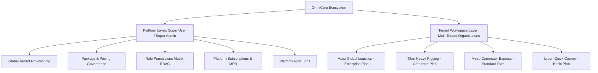
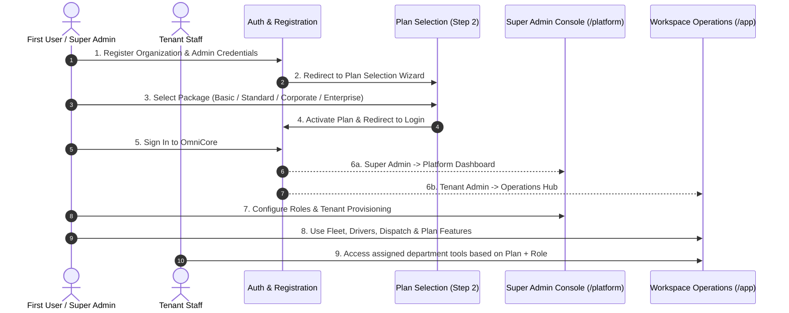

# OmniCore Platform: End-to-End User & Operational Workflow Guide

This document outlines the complete architectural, operational, and user workflow of the **OmniCore Logistics & Fleet OS Platform**. It is designed as a practical master guide for administrators, operators, and platform stakeholders.

---

## 1. System Architecture & User Hierarchy

OmniCore operates on a **Decoupled Multi-Tenant Architecture** featuring two distinct operating layers:



### Hierarchy Breakdown:
1. **The Platform Super User (`super_admin`)**:
   - The first user of OmniCore possessing supreme platform-wide authority.
   - Governs all isolated tenant organizations, sets subscription tiers, monitors MRR, audits platform logs, and dynamically configures granular permissions for every tenant role.
2. **The Tenant Organization Administrator (`tenant_admin`)**:
   - The primary organizational user created upon company registration.
   - Controls organizational configuration, invites department staff, assigns roles, and manages company billing/subscriptions.
3. **Departmental & Field Roles**:
   - Specialized users with scoped access (Operations Manager, Fleet Manager, Finance User, HR Lead, Warehouse Supervisor, Sales/CRM Lead, Driver).

---

## 2. Step-by-Step User Journey & Workflow



---

## 3. Account Creation & Subscription Workflow

### Step 1: Organization Registration (`/auth/register`)
- The first user registers their organization by providing:
  - **Company / Organization Name** (e.g., *Apex Global Logistics*)
  - **Administrator Full Name & Phone**
  - **Corporate Work Email Address**
  - **Security Password** (min. 6 characters)
  - **Account Level**: Check *Platform Super User* for global platform authority, or proceed as standard Tenant Organization Admin.
- Upon submission, the organization is initialized with a unique tenant ID and slug (e.g., `apex-global`).

### Step 2: Choosing a Subscription Plan (`/auth/select-plan`)
Immediately following account creation, the user is guided to the full-screen **Plan Setup Wizard**:

| Subscription Plan | Monthly Price | Annual Price (Save 17%) | Vehicle Cap | Target Operator Segment |
| :--- | :--- | :--- | :--- | :--- |
| **Basic Starter** | **$149 / mo** | $1,490 / yr | Up to 25 Vehicles | Growing local transport & courier agencies |
| **Standard Fleet** | **$399 / mo** | $3,990 / yr | Up to 100 Vehicles | Regional logistics & commercial carriers |
| **Corporate Enterprise** | **$899 / mo** | $8,990 / yr | Up to 500 Vehicles | Large B2B contract haulers & multi-hub networks |
| **OmniCore Ecosystem (Enterprise)** | **$1,899 / mo** | $18,990 / yr | Unlimited (9,999) | National conglomerates, cold-chain & 3PLs |

- **Billing Cycle Selection**: Toggle between **Monthly** or **Annual Billing** (includes automatic discount calculations).
- **Activation**: Clicking **"Activate & Launch Workspace"** updates the organization's subscription package in real-time, sets renewal dates, and redirects to the sign-in screen with an automated confirmation badge.

---

## 4. Authentication & Routing Workflow

### Sign-In (`/auth/login`)
- Enter work email and password.
- **Quick Demo Access Roles**: One-click demo access buttons for instant previewing:
  - **Super Admin** (`admin@gmail.com`)
  - **Tenant Admin** (`sarang@apexlogistics.com`)
  - **Operations Manager** (`operations@apexcargo.com`)
  - **Platform Super Admin** (`admin@omnicore.io`)
- **Smart Role-Based Redirection**:
  - `isPlatformUser: true` $\rightarrow$ Redirects to `/platform/dashboard` (Super Admin Governance Portal).
  - `isPlatformUser: false` $\rightarrow$ Redirects to `/app/dashboard` (Tenant Operations Workspace).
- **Two-Factor Authentication (MFA)**: If enabled, prompts for the 6-digit authenticator code (`/auth/mfa`).
- **Session Protection**: Handled via JWT tokens (`access_token` and `refresh_token`) with automatic Axios interceptor refresh and an application-level `ErrorBoundary` preventing blank screens.

---

## 5. Role Assignment & Permission Governance (4 Core System Roles)

OmniCore operates with **4 core roles**. The Platform Super Admin has supreme authority to assign roles and customize granular role permissions via the **Role Permissions & User Assignments Console** (`/platform/roles`).

### The 4 System Roles:

| Role Code | Role Title | Core Responsibilities | Default Access Scopes |
| :--- | :--- | :--- | :--- |
| `super_admin` | **Platform Super Admin** | Global platform governance, tenant provisioning, subscription packages, pricing, platform audits, role & permission governance | Supreme Platform & Cross-Tenant Authority (`*`) |
| `tenant_admin` | **Tenant Organization Admin** | Executive control of organizational workspace, fleet operations, staff management, settings | Full Workspace Authority within Tenant (`*`) |
| `platform_manager` | **Platform Manager** | Operational management across fleet vehicles, driver registry, trip dispatching, workshop maintenance, warehouse stock, and finance | Fleet, Drivers, Trips Dispatch, Maintenance, Warehouse, Finance & Reports |
| `custom_role` | **Custom Role** | Tailored role configured with specific capabilities selected by the Super Admin for each user | Granular permissions chosen per user from the permissions matrix |

### Super Admin Role Assignment Workflow (`/platform/roles`):
1. **Assigned Roles Directory**:
   - The Super Admin navigates to `/platform/roles` to view the comprehensive directory of assigned roles, their corresponding active users, work emails, phones, workspace organizations, and granted capabilities.
2. **Assigning a New User to a Role**:
   - Click the **"+ New Role Assignment"** button in the top right corner.
   - Enter user details (First Name, Last Name, Work Email, Contact Phone).
   - Select one of the 4 roles: `super_admin`, `tenant_admin`, `platform_manager`, or `custom_role`.
   - **For Custom Roles**:
     - The modal dynamically opens the **Custom Role Permissions Selector**.
     - Optionally enter a custom title (e.g. *Senior Route Dispatcher*, *Billing Auditor*, *Warehouse Lead*).
     - Select specific granular permissions across functional modules:
       - 🚛 **Fleet Management**: `fleet.view`, `fleet.manage`
       - 👤 **Driver Management**: `drivers.view`, `drivers.manage`
       - 🗺️ **Trips & Dispatch**: `trips.view`, `trips.manage`, `trips.dispatch`
       - 🔧 **Workshop Maintenance**: `maintenance.view`, `maintenance.manage`
       - 📦 **Warehouse & Inventory**: `warehouse.view`, `warehouse.manage`
       - 💳 **Finance & Billing**: `finance.view`, `finance.manage`, `contracts.view`, `contracts.manage`
       - 👥 **HR & Personnel**: `hr.view`, `hr.manage`, `payroll.view`, `payroll.manage`
       - 📊 **Reports & Analytics**: `reports.view`, `reports.export`, `reports.custom`
       - ⚙️ **Workspace Settings**: `settings.view`, `settings.manage`
     - Utilize quick presets (*Operations & Dispatch*, *Fleet & Maintenance*, *Finance & Contracts*, *Warehouse & Inventory*, *Select All*, *Clear*).
   - Choose the target tenant workspace organization (or Global Platform scope for Super Admins).
   - Choose account status (*Active Immediately* or *Send Email Invitation*).
   - Click **"Confirm Role Assignment"**.
3. **Role Inspection & Editing**:
   - For custom role users, view their assigned permissions directly in the table as interactive token chips.
   - Click **"View/Inspect Custom Perms"** to open the capability inspector drawer.
   - Click the **Edit** action icon on any assigned user to reassign their role or adjust their custom permissions in real time.
   - Click the **Revoke** action icon to remove role privileges.

---

## 6. Plan-Based Feature Entitlements (PBAC)

Every operational module in OmniCore is governed by **Plan-Based Access Control (PBAC)** according to the subscription plan chosen by the user:

```mermaid
graph LR
    subgraph Basic Tier [$149/mo]
        F1[Fleet Management]
        F2[Driver Directory]
        F3[Trip Dispatch]
        F4[Public Portal]
        F5[Reports Hub]
    end

    subgraph Standard Tier [$399/mo]
        F6[Workshop Maintenance]
        F7[Finance & Invoicing]
        F8[Courier & Express Delivery]
        F9[Corporate Shuttle]
    end

    subgraph Corporate Tier [$899/mo]
        F10[Contracts & Tenders]
        F11[Warehouse & Inventory]
        F12[CRM & Sales Pipeline]
        F13[HR & Payroll]
        F14[Insurance & Claims]
        F15[Marketing Campaigns]
    end

    subgraph Enterprise Tier [$1899/mo]
        F16[Real-Time Cold Chain IoT]
        F17[Predictive Maintenance AI]
        F18[Multi-Tenant Consolidation]
    end

    Basic Tier --> Standard Tier
    Standard Tier --> Corporate Tier
    Corporate Tier --> Enterprise Tier
```

### Module Entitlement Matrix:

| Operational Module | Route Path | Required Plan Tier | Add-on Override | Description |
| :--- | :--- | :--- | :--- | :--- |
| **Operations Hub** | `/app/dashboard` | **Basic** | None | Operational KPI dashboard, active vehicles, trip statuses |
| **Fleet Management** | `/app/fleet` | **Basic** | None | Registry of trucks, reefers, buses, vans, odometer logs |
| **Driver Directory** | `/app/drivers` | **Basic** | None | Driver profiles, license verification, safety scores |
| **Bookings & Dispatch** | `/app/trips` | **Basic** | None | Point-to-point dispatch, live route maps, manifest sheets |
| **Public Booking Portal** | `/public/:slug` | **Basic** | None | Customer tracking page & online shipment booking |
| **Reports & Analytics** | `/app/reports` | **Basic** | None | Operational performance logs, CSV/PDF export |
| **Tenant Settings** | `/app/settings` | **Basic** | None | Organization branding, currency, timezones, API keys |
| **Workshop & Maintenance** | `/app/maintenance` | **Standard** | `addon_maintenance_pro` | Service scheduling, spare part wear-and-tear, repair logs |
| **Finance & Invoicing** | `/app/finance` | **Standard** | None | Invoices, client receivables, billing ledgers, taxes |
| **Courier & Express Hub** | `/app/courier` | **Standard** | `addon_last_mile` | AWB tracking, sorting hubs, e-PoD verification |
| **Corporate Shuttle** | `/app/shuttle` | **Standard** | None | Commuter passenger routes, seat rosters, schedules |
| **Contracts & Tenders** | `/app/contracts` | **Corporate** | `addon_contracts` | Long-term B2B client contracts, SLA minimum guarantees |
| **Warehouse & Inventory** | `/app/warehouse` | **Corporate** | `addon_warehouse` | Multi-warehouse bins, spare parts inventory, cross-docking |
| **CRM & Sales Pipeline** | `/app/crm` | **Corporate** | None | Client lead tracking, customer accounts, rate cards |
| **HR & Personnel** | `/app/hr` | **Corporate** | None | Staff directory, leave requests, driver payroll ledger |
| **Insurance & Claims** | `/app/insurance` | **Corporate** | None | Vehicle policy tracking, accident claim dossiers |
| **Marketing Campaigns** | `/app/marketing` | **Corporate** | None | Client promotions, bulk email/SMS dispatch, discounts |

### In-App Upgrade Mechanism:
- If a user on the **Standard Plan** clicks **Warehouse & Inventory** or **Contracts & Tenders**, the application displays the **Plan Feature Restricted** screen.
- The user can review the plan comparison, vehicle quotas, and feature list.
- **Super Admins & Tenant Admins** can click **"Instant Upgrade"** to immediately upgrade the organization's tier to Corporate or Enterprise, unlocking the module instantly without manual redeployment.

---

## 7. Master Operational Step-by-Step Guide

### Phase 1: Platform Setup & Governance (Super Admin)
1. **Navigate to `/platform/dashboard`**:
   - Review total active tenants, aggregate platform MRR, and platform health.
2. **Review & Provision Tenants (`/platform/tenants`)**:
   - Inspect connected customer workspaces, subscription status, and vertical assignments.
3. **Configure Subscription Tiers (`/platform/packages`)**:
   - Adjust vehicle limits, seat caps, monthly/annual prices, and base package inclusions.

---

### Phase 2: Day-to-Day Operations (Tenant Workspace)
1. **Fleet Onboarding (`/app/fleet`)**:
   - Click **"Add Vehicle"** to register commercial assets (Truck, Reefer, Van, Bus, Machinery).
   - Enter Vehicle Registration, VIN, Fuel Type, Cargo Payload Capacity, and GPS Tracker ID.
2. **Driver Assignment (`/app/drivers`)**:
   - Add drivers, upload driver licenses, medical fitness records, and emergency contacts.
   - Assign primary vehicles to drivers.
3. **Trip Dispatch & Manifest Creation (`/app/trips`)**:
   - Create new dispatch orders: Select Origin, Destination, Cargo Weight, and Assigned Vehicle/Driver.
   - Monitor live dispatch status: *Scheduled*, *In Transit*, *Delayed*, *Delivered*.
4. **Maintenance Schedules (`/app/maintenance`)**:
   - Set preventive service intervals (e.g., oil changes every 15,000 km).
   - Log completed workshop work orders and track mechanical downtime.
5. **Billing & Invoicing (`/app/finance`)**:
   - Generate automated invoices from completed trips with mileage and weight billing.
   - Track paid, pending, and overdue accounts receivable.
6. **Public Client Booking (`/public/apex-global`)**:
   - Provide external corporate customers with the self-service booking portal.
   - Customers can track active shipments in real-time via AWB / Consignment number.

---

## 8. Summary of Workflow Rules

> [!IMPORTANT]
> **Key Operating Rules:**
> 1. **First User Authority**: The Platform Super User has complete oversight across all tenants and can switch role contexts at any time using the header **Role Switcher**.
> 2. **Subscription Isolation**: Operational features unlock dynamically based on the organization's active package tier (`packageTier`) and enabled add-ons.
> 3. **Unified Navigation**: In the Super Admin view, the left navigation displays **Platform Governance** alongside **Workspace Operations**, allowing seamless transition between platform administration and fleet operations.
> 4. **Tenant Context Switching**: Super Admins can switch between active tenant organizations using the **Tenant Switcher** in the top navigation bar to manage individual client workspaces.
